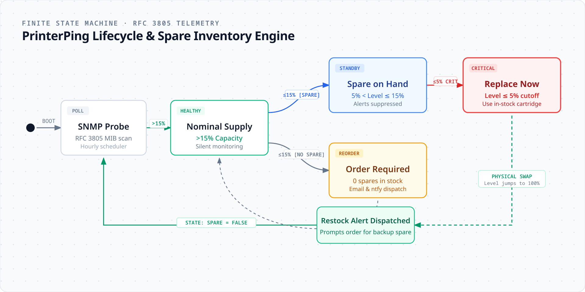

<div align="center">


<p align="center">
  <strong>Zero-dependency, pure-Python SNMP network printer supply monitor and hardware alert daemon.</strong>
</p>

<p align="center">
  <a href="#features">Features</a> &bull;
  <a href="#promo-video">Promo Video</a> &bull;
  <a href="#quick-start">Quick Start</a> &bull;
  <a href="#configuration">Configuration</a> &bull;
  <a href="#how-it-works">How It Works</a> &bull;
  <a href="#license">License</a>
</p>

<p align="center">
  
  
  
  
  
</p>

</div>

---

---

## 🎬 Promo Video

Watch the 60-second product walkthrough video showing real-time SNMP UDP 161 polling, live toner gauges, smart spare inventory matching, and instant low-toner dispatch:

https://github.com/user-attachments/assets/printer-ping-promo.mp4

> **Direct file:** [printer-ping-promo.mp4](printer-ping-promo.mp4) (60s, 1080p, 60fps, high-bitrate SaaS overview)

## ⚡ What is PrinterPing?

Most printer monitoring solutions are bloated, requiring heavyweight agent installations, Java runtimes, proprietary cloud agents, or complex net-snmp C-bindings.

**PrinterPing** is a high-speed, lightweight, **zero-dependency** network printer sentinel written in pure Python. It communicates directly over raw UDP sockets using standard Printer MIBs (RFC 3805 & RFC 1514) to monitor supply levels (toners, imaging drums, waste toner containers) and hardware status (offline events, paper jams, door open states).

### Key Features

- **Zero Third-Party Dependencies**: No `pysnmp`, `pip install`, or external C extensions. Runs immediately on any machine with standard Python.
- **Smart Spare Inventory Tracking**: Distinguishes between *"Order a replacement"* vs *"Replace now using your in-stock office spare"*.
- **Auto-Replacement Detection**: Detects when a cartridge is replaced (levels jump from $\le 5\%$ to $100\%$) and automatically notifies you to reorder a replacement spare for the storeroom.
- **Hardware Health & Jam Alerts**: Detects paper jams and offline conditions, sending one notification when an error occurs and a resolution notice when cleared.
- **Intelligent Deduplication**: Prevents alert floods. Alerts on drop milestones ($\ge 2\%$), critical cutoffs ($\le 5\%$), or via daily digest intervals ($24\text{h}$).
- **Rich HTML & Plain Text Emails**: Clean responsive emails with color-coded supply level gauges and clear action items.

---

## 🚀 Quick Start

### 1. Clone or Download

```bash
git clone https://github.com/your-username/PrinterPing.git
cd PrinterPing
```

### 2. Configure Your Network Printer

Copy the example configuration file:

```bash
cp config.example.toml config.toml
```

Edit `config.toml` with your printer IP and email details:

```toml
[printer]
ip = "192.168.1.200"
name = "Office Multifunction Printer"
snmp_community = "public"

[smtp]
enabled = true
host = "smtp.yourprovider.com"
port = 587
username = "alerts@yourdomain.com"
password = "YOUR_PASSWORD"
to_email = "it-alerts@yourdomain.com"
```

### 3. Run Instant Terminal Health Check

```bash
python cli.py
```

Output:

```text
======================================================================
  [🖨️] PrinterPing — Network Printer Health & Supply Monitor
  Target: Office Multifunction Printer (192.168.1.200)
======================================================================

✓ Printer Hardware Status: Online & Healthy

SUPPLY ITEM          LEVEL                    STATUS
-----------------------------------------------------------------
Black Toner          [##########--]  85%      HEALTHY
Cyan Toner           [####--------]  37%      HEALTHY
Magenta Toner        [#-----------]  12%      LOW (SPARE ON HAND)
Yellow Toner         [############] 100%      HEALTHY
Black Drum Unit      [####--------]  39%      HEALTHY
Waste Toner Box      [--- OK ---]             Healthy / OK
=================================================================
```

### 4. Schedule Automated Background Monitoring

#### On Windows (Task Scheduler or PowerShell):
```powershell
# Run silently in background every hour
$Action = New-ScheduledTaskAction -Execute "pythonw.exe" -Argument "printerping.py" -WorkingDirectory "$PWD"
$Trigger = New-ScheduledTaskTrigger -Once -At (Get-Date) -RepetitionInterval (New-TimeSpan -Hours 1)
Register-ScheduledTask -TaskName "PrinterPing_Monitor" -Action $Action -Trigger $Trigger
```

#### On Linux / macOS (cron):
```bash
crontab -e
# Add the following line to check hourly:
0 * * * * cd /opt/PrinterPing && python3 printerping.py >> /var/log/printerping.cron.log 2>&1
```

---

## 🛠️ Configuration Reference

| Option | Default | Description |
|---|---|---|
| `printer.ip` | `"192.168.1.200"` | IP address or hostname of the printer on your LAN |
| `printer.snmp_community` | `"public"` | SNMP community string (usually `public`) |
| `thresholds.warning_threshold` | `15` | Level percentage that triggers reorder warning |
| `thresholds.critical_threshold` | `5` | Level percentage that triggers critical replacement alert |
| `thresholds.min_drop_realert` | `2` | Minimum percentage drop before sending another alert |
| `thresholds.remind_interval_hours` | `24` | Interval (in hours) to re-notify if supply remains low |
| `notifications.email_enabled` | `true` | Enable or disable SMTP email alerts |
| `notifications.ntfy_enabled` | `true` | Enable or disable phone push alerts via ntfy |
| `ntfy.topic` | `"your-topic"` | ntfy topic name to receive instant phone alerts |
| `ntfy.server` | `"https://ntfy.sh"` | ntfy server URL (public or self-hosted) |
| `spares_initial` | `...` | Set which colors currently have backup cartridges in stock |

### 📱 Phone Push Alerts via ntfy

PrinterPing includes native, zero-dependency integration with [ntfy.sh](https://ntfy.sh):
1. Install the free **ntfy** app on iOS ([App Store](https://apps.apple.com/app/ntfy/id1625396347)) or Android ([Google Play](https://play.google.com/store/apps/details?id=io.heckel.ntfy) / F-Droid).
2. Tap **+** and subscribe to your topic name (e.g. `your-office-printer-alerts`).
3. Set `ntfy_enabled = true` and `email_enabled = false` in `config.toml` for phone-only alerts, or keep both enabled for dual dispatch!

---

## 🧠 Smart Inventory State Engine

PrinterPing maintains a deterministic, lightweight finite state machine (`printerping_state.json`) to prevent alert fatigue while ensuring cartridges are never depleted without backup stock.

<div align="center">
  
</div>

### State Transition Summary
1. **Nominal Monitoring**: Supplies $> 15\%$. Hourly SNMP queries run silently without notifications.
2. **Spare Standby** ($5\% < \text{Level} \le 15\%$): If an in-stock spare is flagged in inventory, standard reorder warnings are suppressed.
3. **Critical Cutoff** ($\text{Level} \le 5\%$): Urgent replacement alert triggers on phone/email (*"Replace now using your in-stock office spare"*).
4. **Auto-Restock Detection**: Once swapped, SNMP detects level jump ($\ge 85\%$), automatically updates spare stock to `False`, and dispatches an instant reorder alert to replace the backup stock.

---

## 📦 Compatibility

Tested and compatible with RFC 3805 Printer MIB compliant network printers:
- **Konica Minolta / Develop ineo**
- **HP LaserJet & PageWide**
- **Xerox VersaLink & WorkCentre**
- **Canon imageRUNNER**
- **Brother Business Series**
- **Ricoh Aficio**
- **Kyocera ECOSYS**

---

## 📄 License

Distributed under the MIT License. See [LICENSE](LICENSE) for more information.

---

Built with help from [Nitech](https://nitech.dev).
